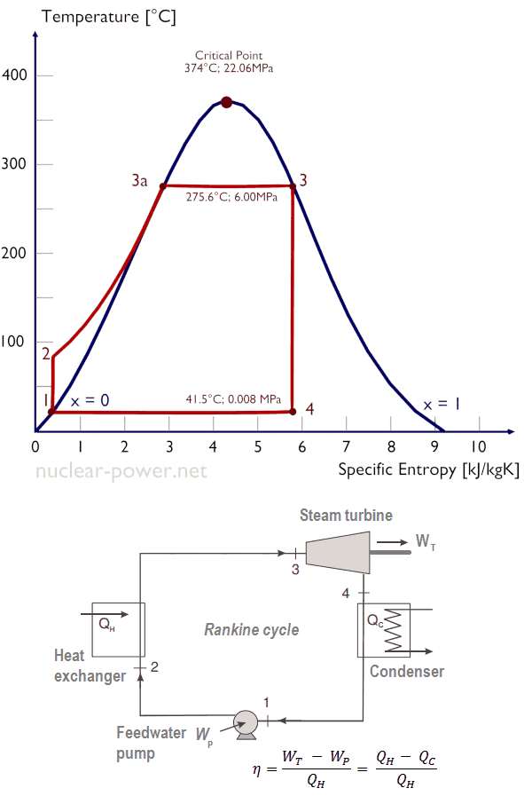

# Readme

This is a basic thermal modelling excercise for a nuclear power plant with storage.
It will be built in three steps:

1. Steady State Rankine Cycle (assuming PWR)
2. Rankine taking into account thermal inertia
3. PWR with thermal storage

A bonus idea is to do an HTR where the graphite also functions as thermal buffer

## Packages used

iapws

## Rankine (steady state)

An overview of a basic rankine cycle.

The following parameters for the cycle are chosen:

| Parameter | Value | Unit | Description |
|-|-|-|-|
| Q_H | 1000 | W | Nuclear thermal power |
| P_high | 6 | MPa | Turbine inlet pressure |
| T_3 | 275 | C | Turbine inlet Temperature |
| T_4 | 40 | C | Turbine outlet Temperature |
| P_low | 0.008 | MPa | Turbine outlet pressure |

## Thermal inertia

A simplified thermal inertia model is used for the heat exchanger.

$$ M_H C_H \frac{dT_H}{dt} = Q_H - (h_2 - h_3) \dot{m} $$

whereby the heat transfered to the steam follows the following reationship:

$$
Q_{steam} = (h_2 - h_3) \dot{m} = (T_H - T_3) UA
$$

For simplicity, the typical primary inlet temperature is used as $T_H$, and $T_3$ is used to represent the secondary side. This give us  the following values:

| Parameter | Value | Unit | Description |
|-|-|-|-|
| T_H | 315 | C | Initial heat exchanger temperature |
| UA | 25.4 | MW/k | Heat transfer coefficient |
| M_H C_H | 500 | MJ/K | Heat capacity |

Time integration uses forward euler for $T_H$